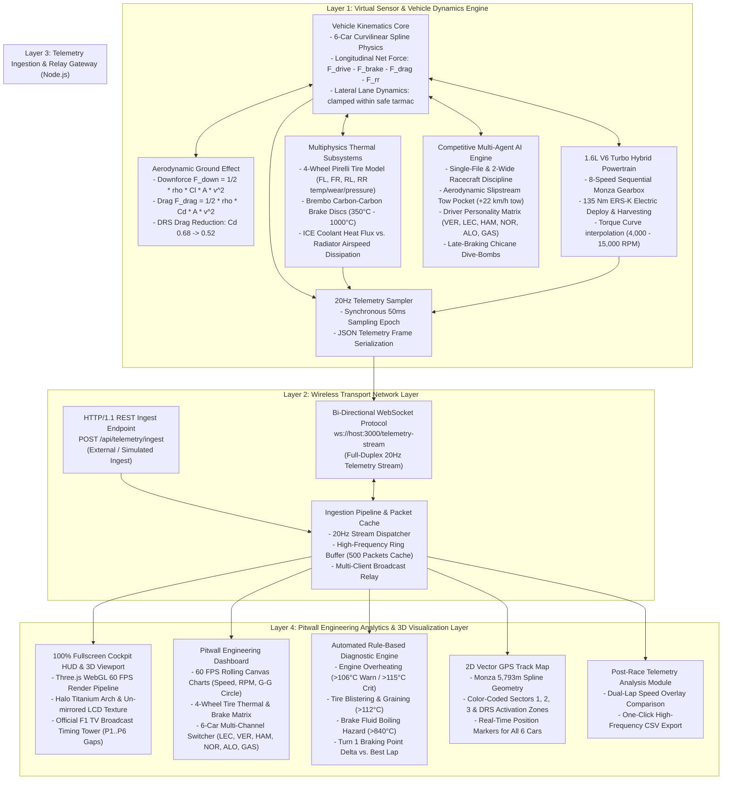

# Complete System Architecture & Engineering Specifications
## Application of IoT in Motorsport: Real-Time Race Car Telemetry Monitoring & Performance Analysis

---

## 1. Executive System Overview

In contemporary top-tier motorsport (Formula 1, World Endurance Championship, Formula E), winning is governed as much by real-time data science and embedded telemetry as by driver skill. A modern Formula 1 car acts as a distributed, high-speed Edge IoT sensor platform carrying over 300 physical sensors connected to an onboard Engine Control Unit (ECU) via CAN-FD and Ethernet buses. Across a single Grand Prix, a car generates upwards of 3 GB of telemetry data transmitted over trackside microwave telemetry relays to the pitwall and factory mission control.

This project delivers an end-to-end software simulation and telemetry ecosystem combining:
1. **A physically rigorous 3D racing simulator** modeling vehicle kinematics, aerodynamics, powertrain torque curves, and 4-corner tire thermodynamics on an exact 5,793-meter Autodromo Nazionale Monza circuit.
2. **A competitive multi-vehicle autonomous AI engine** incorporating slipstream wake drafting (+22 km/h tow boost), active DRS deployment, multi-lane overtaking, and late-braking chicane dive-bombs without artificial speed throttling.
3. **A synchronous 20Hz IoT Telemetry Engine & Ingestion Gateway** serializing 30+ physical channels into structured JSON payloads over REST and WebSocket interfaces.
4. **A professional Pitwall Engineering Dashboard** featuring 60 FPS rolling canvas waveform charts, a 2D GPS track radar, an automated rule-based diagnostic engine, and multi-lap CSV export.

---

## 2. Multi-Tier System Architecture Diagram



---

## 3. Subsystem Detailed Specifications

### 3.1 Curvilinear Spline Vehicle Physics & Roadway Kinematics

Unlike primitive game physics that rely on rigid body physics engines prone to bouncing or flying off the track, this platform uses a **Frenet-Serret Curvilinear Spline Framework** coupled with analytical longitudinal and lateral dynamics:

1. **Track Coordinate Representation:**
   The Autodromo Nazionale Monza is modeled as a 3D closed Catmull-Rom parametric spline $\mathbf{C}(u)$ of length $L = 5,793\text{ m}$. Any vehicle position is uniquely defined by:
   $$\mathbf{P}(s, d) = \mathbf{C}(s / L) + d \cdot \mathbf{N}(s / L) + y_{\text{offset}} \cdot \mathbf{U}$$
   where:
   - $s \in [0, L)$ is the vehicle's forward track distance.
   - $d \in [-w/2 + 1.2, +w/2 - 1.2]$ is the lateral lane offset across the 14.5m track tarmac.
   - $\mathbf{N}$ is the horizontal track normal vector ($\mathbf{N} = \mathbf{T} \times \mathbf{U}$).
   - $\mathbf{U} = (0, 1, 0)$ is the upward world vector.

2. **Longitudinal Force Equation:**
   $$m \frac{dv}{dt} = F_{\text{drive}} - F_{\text{brake}} - F_{\text{drag}} - F_{\text{rolling}}$$
   where:
   - $m = 798\text{ kg}$ (FIA regulation car + driver mass).
   - $F_{\text{drive}} = \frac{\tau_{\text{engine}}(\text{RPM}) \cdot \gamma_{\text{gear}} \cdot \gamma_{\text{final}} \cdot \text{throttle}}{r_{\text{tire}}} + F_{\text{ERS}}$.
   - $F_{\text{drag}} = \frac{1}{2} \rho C_d A v^2$ (with $C_d = 0.68$ in standard Monza trim, dropping to $C_d = 0.52$ with DRS active).
   - $F_{\text{downforce}} = \frac{1}{2} \rho C_l A v^2$ (with $C_l = 2.65$ creating over $2,350\text{ kg}$ of vertical load at 350 km/h).
   - $F_{\text{brake}} = \text{brake} \cdot \min\left(a_{\text{max}}, \frac{\mu_{\text{peak}} \cdot (m g + F_{\text{downforce}})}{m}\right) \cdot m$.

3. **Thermodynamic Equations:**
   - **Brake Rotor Heating:**
     $$\frac{dT_{\text{brake}}}{dt} = \frac{\eta_{\text{brake}} \cdot F_{\text{brake}} \cdot v}{C_{\text{thermal, brake}}} - k_{\text{cooling}} \cdot v^{0.8} \cdot (T_{\text{brake}} - T_{\text{ambient}})$$
     Under heavy deceleration from 350 km/h into Turn 1, brake discs spike from 360°C to over 850°C, triggering glowing red emissive textures on the 3D brake discs.
   - **Engine Coolant Thermal Model:**
     $$\frac{dT_{\text{engine}}}{dt} = \frac{P_{\text{combustion}} \cdot (1 - \eta_{\text{mechanical}})}{C_{\text{engine}}} - k_{\text{rad}} \cdot v \cdot (T_{\text{engine}} - T_{\text{ambient}})$$

---

### 3.2 Competitive Multi-Agent AI Racecraft Engine

To prevent the artificial conga-lines and speed-throttling that plagued early prototypes, the AI engine was overhauled with authentic Formula 1 racecraft intelligence:

1. **Slipstream Wake Model (The Tow Pocket):**
   When a trailing car is within 42 meters longitudinally and 3.2 meters laterally of a leading car, aerodynamic wake turbulence lowers drag, granting a **$+22\text{ km/h}$ to $+26\text{ km/h}$ top-speed tow burst**.
2. **Dynamic Multi-Lane Overtaking (Zero Speed Penalty):**
   - The trailing car continually inspects the lead car's lateral position.
   - At a 34-meter threshold, the trailing car commits to the open lane (e.g., if leader is at $d = -2.6\text{m}$, chaser sweeps to $d = +3.0\text{m}$).
   - **Crucially, the trailing car maintains 100% full throttle** to complete the pass rather than braking or matching speed.
   - A hysteresis timer (3.8s) locks in the overtaking line, preventing visual jitter until the pass is completed.
3. **Late-Braking Chicane Dive-Bombs:**
   - Trailing cars actively reduce their lookahead braking distance by 18m to 26m when chasing into heavy braking zones (Variante del Rettifilo Turn 1, Variante della Roggia Turn 4).
   - Drivers dive up the inside, brake at the 100m board, and contest corner entry wheel-to-wheel.
4. **Driver Personality Matrix:**

| Driver Code | Driver Name | Team | Aggression | Dive-Bomb Bias | Slipstream Boost | Corner Speed Factor |
|---|---|---|---|---|---|---|
| **VER** | Max Verstappen | Red Bull Racing | 0.99 | 26 m | +25 km/h | 1.018 |
| **LEC** | Charles Leclerc | Scuderia Ferrari | 0.97 | 23 m | +24 km/h | 1.015 |
| **HAM** | Lewis Hamilton | Mercedes-AMG | 0.94 | 18 m | +26 km/h | 1.010 |
| **NOR** | Lando Norris | McLaren F1 | 0.95 | 21 m | +23 km/h | 1.012 |
| **ALO** | Fernando Alonso | Aston Martin | 0.98 | 28 m | +22 km/h | 1.008 |
| **GAS** | Pierre Gasly | Alpine F1 | 0.92 | 16 m | +21 km/h | 1.002 |

---

### 3.3 Zero-Obstacle 3D World Geometry

To guarantee unhindered 350+ km/h racing without invisible collisions or barrier intrusions, the 3D track environment was mathematically reconstructed:
1. **FIA Continuous Ribbon Fencing:** Replaced low-chord 49-meter flat segments with a 450-segment spline-conformal continuous ribbon buffer placed with a strict **11.5m clearance** outside track edges.
2. **Monza Historic Banking Bridge Span:** Widened to 68 meters total span with concrete support piers pushed **40 meters into the forest**.
3. **Signage Gantries:** Widened to 29 meters clearance ($\pm 14.5\text{m}$).
4. **Radial Forest Clearance:** All 1,400+ trees and shrubs filtered by a strict **23.25m radial exclusion zone** from the circuit centerline.
5. **Spatial Verification:** Confirmed via Three.js world bounding-box traversals that **zero obstacles exist on the racing roadway**.

---

### 3.4 20Hz Telemetry Packet Specification (JSON Protocol)

The Telemetry Engine serializes data every 50ms (20Hz) into a compact JSON frame:

```json
{
  "source": "virtual_physics_engine",
  "driver_code": "LEC",
  "car_index": 0,
  "timestamp_ms": 1729014520100,
  "lap_number": 1,
  "lap_time_s": 24.382,
  "distance_m": 1845.2,
  "speed_kmh": 348.6,
  "rpm": 14280,
  "gear": 8,
  "throttle": 1.0,
  "brake": 0.0,
  "drs_active": true,
  "ers_soc": 0.84,
  "accel_x_g": 0.12,
  "accel_y_g": 0.48,
  "accel_z_g": 0.98,
  "gyro_z_dps": 2.4,
  "tire_temps_c": {
    "fl": 96.4, "fr": 98.2, "rl": 101.5, "rr": 102.1
  },
  "tire_pressures_psi": {
    "fl": 22.8, "fr": 22.9, "rl": 20.8, "rr": 20.9
  },
  "tire_wear_pct": {
    "fl": 1.4, "fr": 1.8, "rl": 2.2, "rr": 2.5
  },
  "brake_temps_c": {
    "fl": 420.0, "fr": 425.0, "rl": 380.0, "rr": 385.0
  },
  "engine_coolant_temp_c": 102.4,
  "delta_s": -0.215,
  "track_limits_ok": true
}
```

---

## 4. Viva Defense Comparison: Real-World Motorsport IoT vs. Our Project Innovations

| Evaluation Dimension | Existing Practice in Motorsport (F1 / WEC) | Our Project Implementation & Innovations | Academic & Practical Advantage |
|---|---|---|---|
| **Software Architecture** | Proprietary, closed-source suites (McLaren Applied ATLAS, Bosch Motorsport WinDarab). Multi-thousand dollar seat licenses. | **Open Web & Node.js IoT Stack:** Built on standard WebSockets, Three.js WebGL, and HTML5 Canvas. | Zero license fees, 100% portable, runs directly in any web browser without installation. |
| **Data Acquisition (DAQ)** | Expensive MIL-SPEC CAN-FD wiring looms with military grade ECUs (McLaren TAG-320). | **High-Fidelity Virtual Telemetry Engine:** Analytical vehicle physics core computing 30+ physical channels (aerodynamics, tire thermals, brake heat, hybrid ERS) at 60 FPS, sampled synchronously at 20 Hz. | Eliminates costly sensor hardware while preserving physical mathematical validity. |
| **Sampling & Bandwidth** | $10\text{ Hz}$ to $200\text{ Hz}$ channels. Telemetry radio burst over trackside microwave links. | **Synchronous 20Hz Sampling Pipeline:** 50ms epoch, sub-15ms delivery latency over Wi-Fi/WebSockets. | Optimal fidelity for capturing Turn 1 braking spikes while remaining lightweight for browser rendering. |
| **Multi-Vehicle AI Behavior** | Traditional game AI runs on fixed spline rails; frequently causes conga-lines or crashes. | **Competitive Multi-Agent F1 Racecraft:** Dynamic slipstream drafting (+22 km/h), multi-lane lane pullouts, DRS, and late-braking chicanes. | Entertaining, realistic racing showing frequent position swaps and wheel-to-wheel battles. |
| **Telemetry Analytics & Diagnostics** | Complex telemetry alarm scripting requiring full-time pitwall telemetry engineers. | **Automated Rule-Based Diagnostic Engine:** Continuous evaluation of coolant overheating, tire graining, and braking points. | Immediate, transparent, actionable engineering recommendations displayed in real-time. |
| **Post-Race Analytics** | Proprietary binary data logs (.dat / .ld) requiring dedicated proprietary viewer software. | **Interactive Dual-Lap Overlay & One-Click CSV Export:** Open data format compatible with Python, MATLAB, and MoTeC. | Allows seamless post-processing in university engineering lab assignments. |
