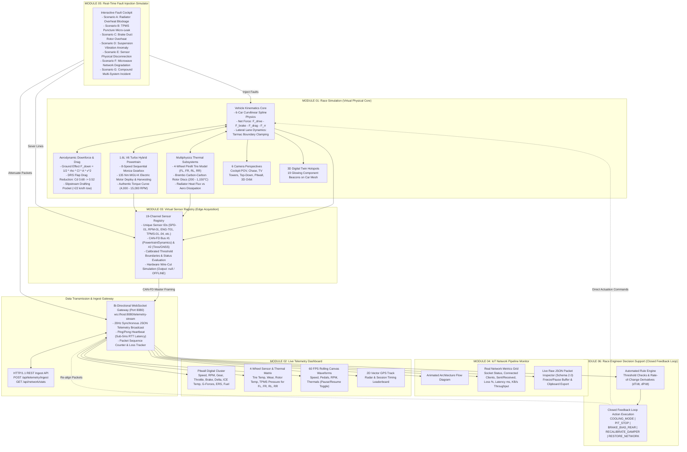

# Complete System Architecture & Engineering Specifications (System 2.0)
## Application of IoT in Motorsport: End-to-End Race Car Telemetry Pipeline, Virtual Sensor Network & Intelligent Race Monitoring

---

## 1. Executive System Overview

In contemporary professional motorsport (Formula 1, World Endurance Championship, Formula E), race outcomes are dictated by the speed, accuracy, and depth of real-time telemetry analytics. A modern Formula 1 single-seater acts as a distributed edge IoT platform equipped with over 300 discrete physical sensors wired to the Engine Control Unit (ECU) via CAN-FD and automotive Ethernet buses. Across a single Grand Prix distance, each car produces over 3 gigabytes of telemetry data streamed over trackside microwave links to garage pitwalls and mission control rooms.

This project delivers an end-to-end software simulation and telemetry ecosystem demonstrating the complete Formula 1 IoT lifecycle:

```
Virtual Physical Environment
       ↓
Sensor Acquisition (19 Calibrated Edge Sensors)
       ↓
Data Transmission (CAN-FD Framing & Master Sequence)
       ↓
IoT Gateway (Node.js WebSocket Server & REST Ingest)
       ↓
Stream Ingestion & Processing (Schema 2.0 Ring Buffers)
       ↓
Real-Time Monitoring (60fps Rolling Waveforms & Gauges)
       ↓
Fault Detection (Rule-Based Thresholds & Trend Derivation)
       ↓
Race Engineering Decision (Closed Feedback Loop Interventions)
```

---

## 2. Multi-Tier System Architecture Diagram



---

## 3. The Six Connected Modules

### Module 01: Race Simulation (3D Virtual Physical Environment)
- Authentic Autodromo Nazionale Monza circuit geometry (5,793 meters).
- Six competitive AI cars with driver personalities:
  - #16 Charles Leclerc (Scuderia Ferrari HP)
  - #1 Max Verstappen (Oracle Red Bull Racing)
  - #44 Lewis Hamilton (Mercedes-AMG PETRONAS)
  - #4 Lando Norris (McLaren Formula 1 Team)
  - #14 Fernando Alonso (Aston Martin Aramco)
  - #10 Pierre Gasly (BWT Alpine F1 Team)
- 6 Camera Perspectives:
  1. `COCKPIT`: Authentic Driver POV with dynamic G-force head sway, apex look-ahead, and speed FOV expansion.
  2. `CHASE`: Dynamic third-person chase camera with speed lag.
  3. `TV_BROADCAST`: Trackside telephoto camera towers panning across Monza curves.
  4. `TOP_DOWN`: Birds-eye overhead tracking view directly above the car.
  5. `PITWALL`: Fixed Monza pitwall gantry view overlooking the start/finish straight.
  6. `ORBIT`: 360-degree free orbit inspection with mouse drag and wheel zoom.
- 3D Digital Twin Component Highlighting on the car body for all 19 sensors.

### Module 02: Live IoT Telemetry Dashboard
- Gauges: Speed, RPM, Gear, Throttle, Brake, Delta, Coolant Temp, Longitudinal & Lateral G-forces, ERS SoC, DRS, Fuel.
- 4-Wheel Thermal Matrix: Surface temperatures, wear percentages, rotor temperatures, and TPMS pressures.
- 2D GPS Track Radar: Vector circuit map with live car transponder markers.
- Live Race Leaderboard: Transponder classification tracking intervals, gaps, and personal best times.
- 60fps Rolling Waveforms: Real-time speed profile, pedal traces, powertrain RPM, and thermal curves with Pause/Resume toggle.
- G-G Traction Circle: Live friction circle displaying lateral vs longitudinal acceleration within the 5G envelope.

### Module 03: Virtual Sensor Management
- 19-sensor hardware registry with unique sensor IDs, car assignments, subsystems, calibrated limits, and CAN-FD bus routing.
- Sensor status evaluation: `ONLINE`, `WARNING`, `CRITICAL`, and `OFFLINE`.
- Wire-Cut Hardware Simulation: Sever any sensor line; reading immediately cuts to `null` and displays `NO DATA (CUT)` — no stale data.
- 3D Twin Locate: Illuminates glowing beacon hotspot directly on the 3D car model.

### Module 04: IoT Network Pipeline Monitor
- Visual Architecture Pipeline showing data flow from Virtual Sensors &rarr; CAN-FD Framing &rarr; WebSocket Gateway &rarr; Telemetry Ingestion &rarr; Pitwall Dashboard.
- Socket Metrics: Status, Client Count, Packets Sent/Received, Master Sequence, Packet Loss %, RTT Latency ms, Sensor Hz, Throughput KB/s.
- Raw JSON Packet Inspector: Freeze stream and copy Schema 2.0 JSON packet.

### Module 05: Real-Time Fault Injection Simulator
- Scenarios A through G:
  - Scenario A: ICE Powertrain Overheat (Radiator blockage slider).
  - Scenario B: Tire Pressure Micro-Leak (Wheel selector + TPMS leak rate).
  - Scenario C: Carbon Rotor Overheat (Brake duct obstruction).
  - Scenario D: Mechanical Suspension Vibration Anomaly (Curb damage).
  - Scenario E: Sensor Physical Line Disconnection (Wiring sever).
  - Scenario F: Wireless Network Degradation (Packet loss + latency injection).
  - Scenario G: Compound Multi-System Crisis (Concurrent multi-faults).
- Master Reset: One-click restoration of all physical parameters to nominal.

### Module 06: Race Engineer Decision Support (Closed Feedback Loop)
- Automated rule engine with threshold and rate-of-change diagnostics.
- Diagnostic event cards displaying Root Cause, Threshold Comparison, Consequence, and Recommended Action.
- Closed Feedback Loop Action Execution: Buttons dispatch commands directly back into the vehicle physics model (`COOLING_MODE`, `PIT_STOP`, `BRAKE_BIAS_REAR`, `RECALIBRATE_DAMPER`, `RESTORE_NETWORK`, `RESET_ALL`).

---

## 4. Dual-Device / Multi-Monitor Presentation Architecture

The application supports running across two separate screens or devices simultaneously:
- **Device A (Screen 1)**: Driver POV / 3D Simulation (`http://localhost:8080/?mode=sim`)
- **Device B (Screen 2)**: Pitwall Telemetry Dashboard (`http://localhost:8080/?mode=dashboard`)
- Both devices communicate bidirectionally over the Node.js WebSocket gateway on port 8080 at 20Hz.
