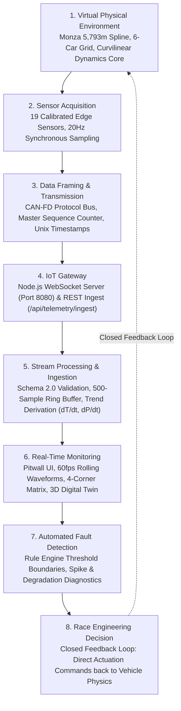

# Formula 1 IoT Architecture & Telemetry Pipeline Specification (System 2.0)

## 1. Complete IoT Lifecycle in Motorsport

In contemporary top-tier motorsport (Formula 1, World Endurance Championship, Formula E), race cars act as mobile high-density IoT edge networks generating upwards of 3 GB of telemetry data per Grand Prix.

This project implements the complete 8-stage motorsport IoT lifecycle:



---

## 2. Layer 1: Virtual Sensor Edge Core (19 Sensors)

Data is acquired at a synchronous **20 Hz frequency** (50 ms epoch) across 19 discrete virtual sensors distributed across two CAN-FD bus networks:

```
Car Chassis / Engine Subsystems
  ├── CAN-FD Bus #1 (High-Priority Powertrain & Dynamics)
  │    ├── SPD-01: Front Wheel Hall Speed Sensor (0–365 km/h)
  │    ├── RPM-01: Crankshaft Magnetic Reluctor (4,000–15,200 RPM)
  │    ├── ENG-T01: ICE Coolant Radiator Thermistor (60–130°C)
  │    ├── BRK-T01 to BRK-T04: 4-Corner Carbon Rotor Optical Pyrometers (200–1,150°C)
  │    ├── ACC-01: 3-Axis Bulkhead Accelerometer (±5.5G Long, ±4.8G Lat)
  │    ├── GYR-01: Solid-State Angular Rate Gyroscope (±120 deg/s)
  │    └── VIB-01: Piezoelectric Bulkhead Vibration Accelerometer (0–5G RMS)
  │
  └── CAN-FD Bus #2 (Tire & Environmental Telemetry)
       ├── TIRE-FL-01 to TIRE-RR-01: 4x Infrared Tire Tread Surface Pyrometers (60–135°C)
       ├── TPMS-01 to TPMS-04: 4x Rim Wheel Valve Pressure Transducers (15–30 psi)
       └── GPS-01: Differential GNSS Timing Transponder (5,793m Monza Centerline)
```

### Sensor Hardware State Model
Each sensor maintains an explicit connection state:
- `connected = true`: Sensor actively streams physical measurements.
- `connected = false`: Sensor CAN wiring severed. Output immediately cuts to `null` with status `OFFLINE`. The monitoring layer displays `NO DATA (CUT)`, preventing stale data from masquerading as fresh telemetry.

---

## 3. Layer 2: Network Transport & Protocol Metrics

### WebSocket Full-Duplex Link (`/telemetry-stream`)
- Telemetry packets are serialized into JSON Schema 2.0 and transmitted every 50ms over standard WebSockets.
- Client browsers and pitwall dashboards maintain persistent connections to `ws://localhost:8080/telemetry-stream`.

### Network Health & Performance Metrics
The network monitor (`IoTTelemetryBridge`) measures real network statistics:
1. **Packet Sequence Counter**: Every packet carries an incremental `master_seq`.
2. **Packet Loss Detection**:
   $$\text{Packet Loss \%} = \frac{\text{Missing Sequences}}{\text{Expected Sequences}} \times 100$$
3. **Round-Trip Time (RTT) Latency**:
   The client periodically transmits a heartbeat ping packet containing timestamp $t_{\text{sent}}$. The server echoes the timestamp in a pong response at $t_{\text{recv}}$:
   $$\text{RTT Latency} = t_{\text{recv}} - t_{\text{sent}}$$
4. **Throughput Calculation**:
   $$\text{Throughput (KB/s)} = \frac{\sum \text{Bytes Received in Window}}{1024 \times \Delta t_{\text{sec}}}$$

---

## 4. Layer 3: Node.js Ingestion Gateway

The gateway server (`server.js`) operates on Node.js and Express with the `ws` library:
- **WebSocket Gateway (`/telemetry-stream`)**: Broadcasts incoming 20Hz telemetry packets to all connected race engineer clients concurrently.
- **REST Ingestion Endpoint (`POST /api/telemetry/ingest`)**: Allows external telemetry feeds, hardware microcontrollers, or test harnesses to push telemetry frames.
- **Network Statistics Endpoint (`GET /api/network/stats`)**: Reports connection status, client counts, buffer size, and server uptime.
- **500-Sample Ring Buffer**: Caches recent telemetry frames in memory to immediately populate historical waveform graphs upon new client connection.

---

## 5. Layer 4: Real-Time Stream Processing & Ingestion

The browser-native `TelemetryEngine`:
- Ingests packets at 20 Hz, deserializing into normalized ring buffers.
- Derives dynamic rates of change:
  - Thermal rate of change: $\frac{dT_{\text{ice}}}{dt}$ and $\frac{dT_{\text{brake}}}{dt}$
  - Pneumatic decay rate: $\frac{dP_{\text{tire}}}{dt}$
- Compares readings against calibrated warning and critical boundaries.
- Triggers diagnostic event notifications into the active alerts register.

---

## 6. Layer 5: Real-Time Monitoring & 3D Digital Twin

- **60 FPS Rolling Waveform Canvases**: Visualizes speed, pedal traces, powertrain RPM, and thermal profiles. Supports instant Pause/Resume for trace inspection.
- **4-Corner Thermal Matrix**: Displays independent surface temperature, wear percentage, carbon rotor temperature, and TPMS pressure for FL, FR, RL, RR.
- **3D Digital Twin Component Highlighting**: Clicking "3D Twin" on any sensor in the registry illuminates a glowing visual beacon at the exact physical component coordinates on the 3D car model, providing spatial context for physical failures.

---

## 7. Layer 6 & 7: Fault Simulator & Closed-Loop Decision Support

### Real-Time Fault Injection (Scenarios A through G)
- **Scenario A**: ICE Coolant Radiator Blockage (50–100%) &rarr; engine coolant rises past 114°C.
- **Scenario B**: Tire Carcass Micro-Leak &rarr; pressure decays at -0.55 psi/sec.
- **Scenario C**: Brake Duct Blockage &rarr; carbon rotor temperature exceeds 1,020°C into Turn 1.
- **Scenario D**: Suspension Mechanical Harmonic Chatter &rarr; vibration exceeds 3.5G RMS.
- **Scenario E**: Sensor Line Severance &rarr; sensor output drops to `null`, status `OFFLINE`.
- **Scenario F**: Microwave RF Degradation &rarr; 40% packet loss, 140ms RTT delay.
- **Scenario G**: Compound Multi-Fault Crisis &rarr; concurrent engine overheating, tire puncture, and brake fade.

### Closed Feedback Loop Interventions
When the rule engine diagnoses an anomaly, Module 06 provides direct intervention action buttons that execute closed-loop commands back into the vehicle dynamics model:

| Action Command | Target Subsystem | Physical Effect in Simulation Engine |
|---|---|---|
| `COOLING_MODE` | Powertrain Controller | Engages Engine Map 3 & 90m Lift-and-Coast; drops engine thermal generation by 45%. |
| `PIT_STOP` | Wheel / Tire Mechanics | Commands pit lane box; resets tire wear to 0.0% and restores tire pressure to 21.0 psi. |
| `BRAKE_BIAS_REAR` | Braking Hydraulic Line | Shifts brake bias +4% rearward; backs off Turn 1 braking mark by 20m. |
| `RECALIBRATE_DAMPER` | Active Suspension | Recalibrates electronic damping coefficients; reduces mechanical vibration below 1.2G RMS. |
| `RESTORE_NETWORK` | Telemetry Link | Clears simulated RF attenuation and resets packet drop rate to 0.0%. |
| `RESET_ALL` | Master Vehicle State | Restores all physical parameters, duct blockages, leak rates, and sensor lines to nominal. |

---

## 8. Dual-Device Hardware Topology

The platform supports running across two separate screens or devices simultaneously:
- **Device A (`?mode=sim`)**: 3D Three.js WebGL simulation running on the primary display.
- **Device B (`?mode=dashboard`)**: Pitwall IoT telemetry dashboard running on a secondary monitor, tablet, or examiner laptop.
- The Node.js WebSocket gateway relays telemetry and intervention commands bidirectionally between Device A and Device B in real time.
