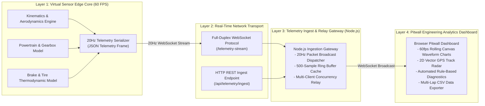

# IoT Architecture & Wireless Telemetry Pipeline

## 1. System Architecture Overview

In contemporary motorsport (Formula 1, WEC, Formula E), cars are mobile high-density IoT sensor networks generating upwards of 3 GB of telemetry data per Grand Prix.

This project implements an end-to-end telemetry pipeline demonstrating the complete path from physical or virtual sensor acquisition through wireless transmission, ingestion, real-time analytics, and engineering decision support:



---

## 2. Telemetry Ingest Architecture

### 20Hz Synchronous Telemetry Pipeline
- Vehicle kinematic equations, aerodynamic downforce ($F = \frac{1}{2}\rho C_l A v^2$), and thermal dissipation models run at 60 FPS in the simulation engine.
- The `TelemetryEngine` samples these 30+ physical channels at a synchronous **20 Hz rate** (every 50 ms).
- Structured JSON telemetry packets are streamed via WebSocket to the Node.js server, which broadcasts the live data stream to all connected client pitwall dashboards concurrently.
- An open REST endpoint (`POST /api/telemetry/ingest`) is also provided to support programmatic telemetry injection from external data feeds.

---

## 3. Network Bandwidth & Latency Analysis

| Parameter | Theoretical / Measured Value | Formula 1 Equivalent Standard |
|---|---|---|
| **Sampling Frequency** | $20 \text{ Hz}$ ($50 \text{ ms}$ interval) | $10 - 200 \text{ Hz}$ depending on channel |
| **Payload Size** | $\approx 280 \text{ bytes / packet}$ (JSON) | ATLAS binary compact frame ($\approx 120 \text{ bytes}$) |
| **Data Throughput** | $20 \times 280 \approx 5.6 \text{ KB/s}$ ($44.8 \text{ kbps}$) | $2.4 - 5.0 \text{ Mbps}$ telemetry burst |
| **Wi-Fi Transport Latency** | $4 - 12 \text{ ms}$ (Local AP) | $15 - 35 \text{ ms}$ (ATLAS cellular/trackside radio) |
| **Render Latency** | $\approx 16 \text{ ms}$ ($60 \text{ fps}$ RAF) | $< 50 \text{ ms}$ pitwall display latency |

---

## 4. REST Ingestion API Specification

### Endpoint: `POST /api/telemetry/ingest`
- **Content-Type**: `application/json`
- **Request Body**:
```json
{
  "source": "virtual_physics_core",
  "timestamp_ms": 1729014520100,
  "lap": 1,
  "lap_time_s": 14.85,
  "speed_kmh": 318.4,
  "accel_x_g": 0.04,
  "accel_y_g": 0.42,
  "accel_z_g": 0.98,
  "gyro_z_dps": 1.2,
  "temperature_c": 36.8,
  "ir_trigger": false,
  "battery_v": 3.82,
  "rssi_dbm": -56,
  "sensor_status": "ONLINE"
}
```
- **Response**: `200 OK`
```json
{ "status": "ACK", "timestamp": 1729014520112 }
```
