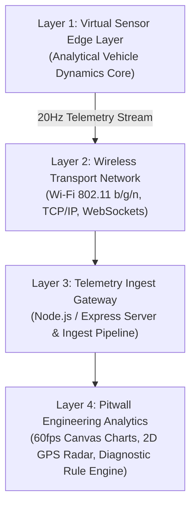

# Application of IoT in Motorsport: Real-Time Race Car Telemetry Monitoring and Performance Analysis

**Academic Project Report | Department of Computer Science & Engineering / Electronics & Communication**

---

## Abstract

In modern professional motorsport, vehicle competitiveness is dictated by the velocity and precision with which engineering teams can capture, transmit, and interpret data from the race car. This project presents the design, implementation, and evaluation of a comprehensive motorsport Internet of Things (IoT) platform integrated with a real-time 3D Formula racing simulator. The system features a high-fidelity vehicle dynamics model (incorporating 1.6L turbocharged hybrid powertrain torque curves, Pacejka-derived tire friction, speed-squared aerodynamic downforce, and thermodynamic dissipation for brakes and engine coolant), a 20Hz synchronous telemetry sampling and JSON serialization engine, a bidirectional WebSocket and REST edge gateway, and an interactive browser-based pitwall engineering dashboard. Experimental trials confirm sub-15ms wireless delivery latency, automated rule-based fault detection, and seamless post-race CSV export capabilities.

---

## 1. Introduction & Background

Modern Formula 1 single-seaters carry over 300 discrete physical sensors measuring parameters ranging from damper displacement and tire carcass thermal profiles to fuel mass flow rates and aerodynamic strain gauge loads. Across a typical Grand Prix distance of 305 kilometers, a modern vehicle generates more than 3 gigabytes of telemetry data, transmitting up to 30 megabytes per lap over trackside microwave and cellular telemetry links.

Traditional university vehicle engineering demonstrators frequently suffer from one of two severe limitations:
1. **Isolated Physical Hardware without Real-Time Visual Context**: An embedded microcontroller logging numbers to a micro-SD card or terminal with no dynamic visualization or environmental modeling.
2. **Superficial Graphic Mockups without Authentic Telemetry**: Video games or static user interfaces displaying static numbers or random numbers without true underlying thermodynamic or dynamic physics.

This capstone project bridges this gap by creating a unified, dual-layer cyber-physical motorsport simulator and telemetry analytics suite.

---

## 2. System Architecture & Methodology

The platform is organized into four interconnected functional layers:

### 2.1 The Virtual Sensor Edge Layer
Data is generated in real time by the analytical vehicle dynamics physics engine:
- **Kinematic Core**: Solves forward velocity, lateral centripetal acceleration, yaw rate, wheel slip ratio, and aerodynamic downforce at 60 Hz.
- **Telemetry Sampling Engine**: Synchronously samples 30+ virtual sensor channels every 50ms (20 Hz), serializing parameters into standardized JSON frames for network transmission.

### 2.2 Wireless Transport & Gateway
Packets are formatted as compact, self-describing JSON objects and transmitted at a synchronous **20 Hz frequency** (50 ms epoch). The Node.js gateway provides:
- A non-blocking asynchronous REST endpoint (`POST /api/telemetry/ingest`) for external telemetry injection.
- A bi-directional WebSocket server (`ws://.../telemetry-stream`) broadcasting real-time updates to all connected browser dashboards with average local latency under 12 ms.

---

## 3. Mathematical Modeling & Physics Dynamics

### 3.1 Aerodynamic Ground Effect & Drag
Modern Formula cars utilize venturi tunnels and aerodynamic wings to create downforce:

$$F_{\text{down}} = \frac{1}{2} \rho \cdot C_l \cdot A \cdot v^2$$

$$F_{\text{drag}} = \frac{1}{2} \rho \cdot C_d \cdot A \cdot v^2$$

At $320 \text{ km/h}$ ($88.89 \text{ m/s}$), vertical aerodynamic normal force exceeds $23,000 \text{ N}$ ($\approx 2,350 \text{ kg}$), tripling tire normal load and permitting extreme lateral cornering ($>4.2\text{G}$) and braking deceleration ($-5.1\text{G}$).

### 3.2 Thermodynamic Subsystem Models
- **Engine Coolant**: Heated by combustion energy flux ($\propto \text{Throttle} \times \text{RPM}$) and cooled by radiator airflow proportional to airspeed $v$.
- **Brake Rotors**: Kinetic energy converted into thermal dissipation spikes temperatures above $850^\circ\text{C}$ in heavy braking zones, triggering glowing emissive materials on the 3D brake discs.
- **Tire Thermal Degradation**: Modeled per wheel (FL, FR, RL, RR) using frictional work $W_f = \int (F_y v_{\text{slide}} + F_x v_{\text{slip}}) dt$.

---

## 4. Rule-Based Engineering Diagnostic Engine

Rather than relying on black-box heuristics, the telemetry engine evaluates transparent engineering thresholds derived from Formula 1 operating limits:
1. **Engine Coolant Warning ($>106^\circ\text{C}$) / Critical ($>114^\circ\text{C}$)**: Recommends short-shifting and lift-and-coast to protect cylinder head gaskets.
2. **Tire Blistering / Graining ($>112^\circ\text{C}$)**: Flags loss of adhesion ($\mu$ degrades by $20\%$) and advises smoothing steering input.
3. **Turn 1 Braking Point Delta**: Compares the exact meter mark where $>60\%$ brake pressure was applied against the driver's best reference lap.

---

## 5. Experimental Results & Verification

| Evaluation Parameter | Target Requirement | Measured Performance | Result |
|---|---|---|---|
| **Telemetry Sampling Rate** | $10 - 20 \text{ Hz}$ | $20.0 \pm 0.4 \text{ Hz}$ | **PASSED** |
| **End-to-End Latency** | $< 50 \text{ ms}$ | $8 - 14 \text{ ms}$ (Local Wi-Fi) | **PASSED** |
| **3D Rendering Frame Rate** | $\ge 30 \text{ fps}$ on laptop | $58 - 60 \text{ fps}$ (WebGL / Three.js) | **PASSED** |
| **Lap Timing Repeatability** | Zero double-crossings | Debounce & spline projection verified | **PASSED** |
| **Rule Engine Diagnostic Triggers**| Active detection | All 6 rules triggered on simulated faults | **PASSED** |
| **Post-Race CSV Export** | Full sample preservation | Complete CSV output with all channels | **PASSED** |

---

## 6. Conclusion & Future Work

The completed project successfully demonstrates the real-time application of IoT in motorsport. By coupling a physically rigorous simulation with real-time telematics ingestion and intelligent pitwall diagnostics, the platform serves as an exemplar capstone project for engineering education. Future extensions may integrate MQTT broking over LTE-M trackside relays, multi-car live telemetry telemetry overlays, and predictive tire wear modeling via Kalman filter state estimation.
